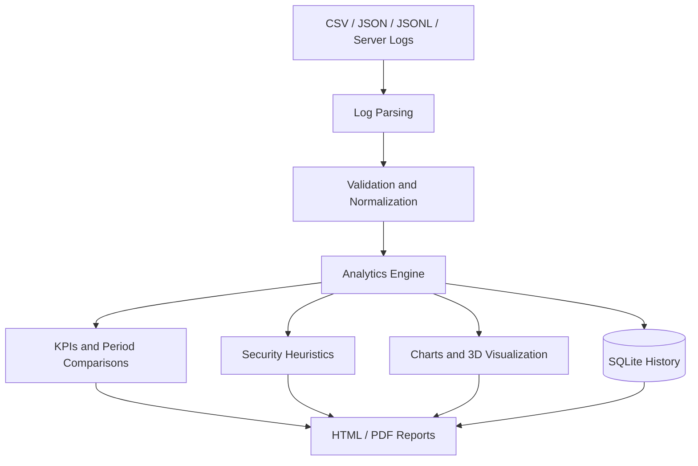
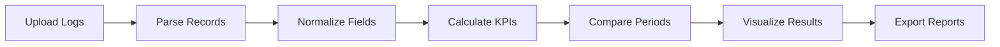
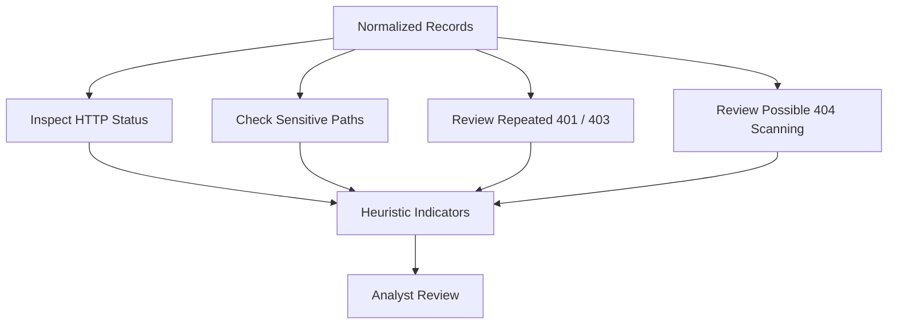
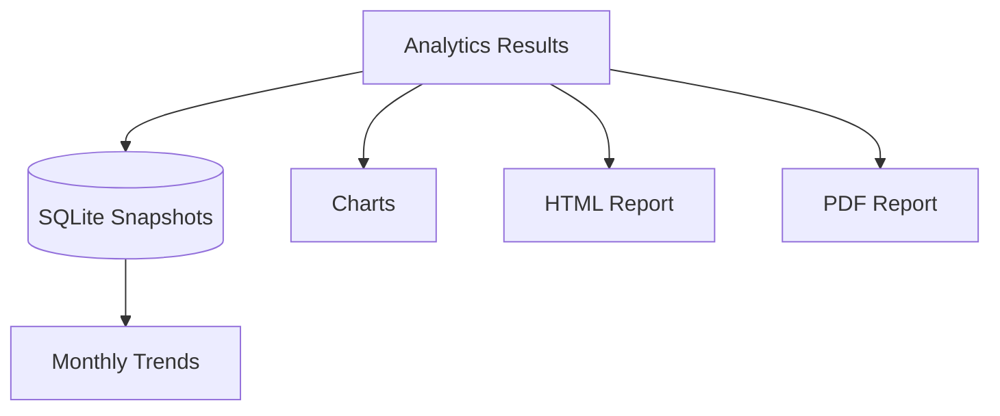

# ServerLog Intelligence — Security & Performance Analytics

A Google Colab-based server-log analytics project that normalizes common log formats and produces operational KPIs, period comparisons, charts, 3D telemetry visualization, heuristic security indicators, SQLite history, and shareable HTML/PDF reports.

## Why this project?
Server logs are often distributed across different formats and contain too much detail for quick manual review. This project provides a repeatable workflow to summarize request volume, identify error-heavy endpoints, inspect latency, compare time periods, and highlight suspicious patterns for further investigation.

## Key features
- Multi-format input: CSV, JSON/JSONL, common Apache/Nginx access logs, syslog/auth.log, and best-effort Cloudflare/AWS JSON mappings.
- Data-quality checks and normalized request records.
- KPIs: request volume, unique IPs, HTTP error rate, 5xx errors, mean latency, and p95 latency.
- HTTP status distribution, endpoint error comparison, traffic and latency time series.
- Latest date vs previous date and current week-to-date vs previous full week comparisons.
- Heuristic indicators for sensitive-path probing, repeated 401/403 responses, and 404 scanning.
- 3D visualization of timestamp, latency, and HTTP status when fields are available.
- SQLite daily snapshots and monthly trend plots.
- Exportable HTML and PDF reports.

## Run in Google Colab
1. Upload `ServerLog_Intelligence_Analytics_Colab.ipynb` to Google Colab.
2. Run cells from top to bottom.
3. Upload a sanitized `.csv`, `.json`, `.jsonl`, `.log`, or `.txt` log file when prompted. If no file is uploaded, synthetic demonstration data is used.
4. Review the normalized data, KPIs, comparison tables, charts, and security indicators.
5. Download the generated HTML/PDF reports, SQLite database, and this README as needed.

## Example input fields
The parser attempts to map common names for timestamp, IP/client address, HTTP method, path/URL, status code, response time, and user agent. Not all formats include every field; for example, syslog and CloudTrail events may not have HTTP status or response latency.

## Repository structure
```text
ServerLog_Intelligence_Analytics_Colab.ipynb
README.md
screenshots/       # Add screenshots of actual notebook outputs
sample_logs/       # Add sanitized sample data only
reports/           # Optional example reports; avoid committing sensitive data
```

## Limitations and responsible use
- Format mapping is best-effort because AWS and Cloudflare schemas vary by product and export configuration.
- Security indicators are heuristics and may produce false positives; they do not establish that an IP is malicious or a server is compromised.
- IP geolocation and reputation checks are intentionally not required by this notebook.
- Period comparisons use UTC and the latest date present in the uploaded dataset. Meaningful comparisons require data for both periods.
- SQLite storage in a Colab runtime is temporary unless the database is downloaded or saved to persistent storage such as Google Drive.
- Do not upload secrets, credentials, personal information, or unredacted production logs to public repositories or shared notebooks.

<!-- SERVERLOG_DIAGRAMS_START -->

## System Architecture



## Data Processing Pipeline



## Security Analysis Workflow



## Database and Reporting



> Security indicators are heuristic signals for investigation; they do not independently prove malicious activity.

<!-- SERVERLOG_DIAGRAMS_END -->

## Technology stack
Python, Pandas, NumPy, Matplotlib, SQLite, ReportLab, and Google Colab.

## Future improvements
Schema-specific CloudTrail/Cloudflare adapters, automated tests, richer anomaly detection, dashboard deployment, and scheduled collection can be added as separate extensions.

## License
Choose a license before publishing (for example, MIT if you want to permit reuse with attribution).

## Author
Add your name, portfolio, and LinkedIn/GitHub profile here.
